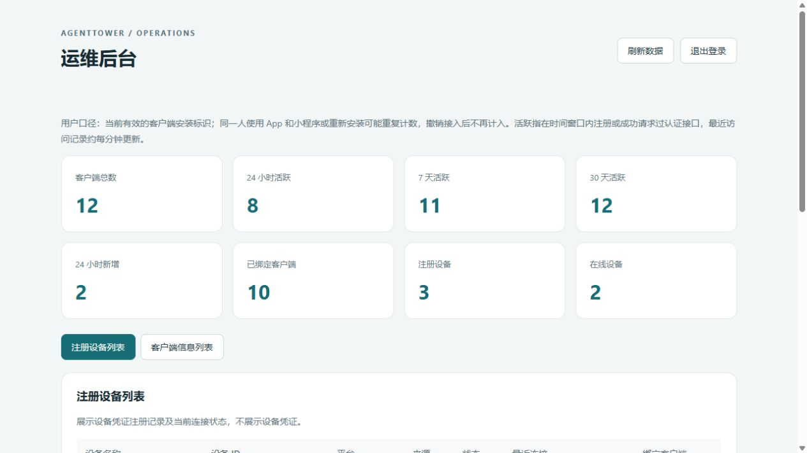
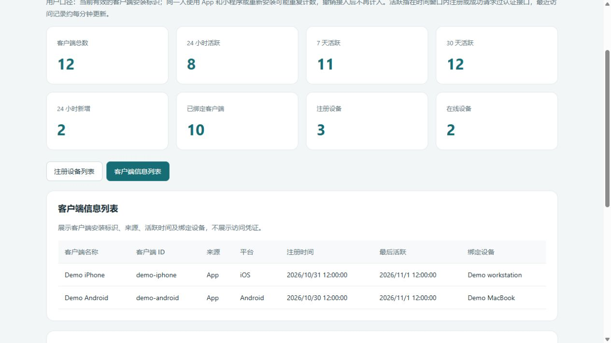
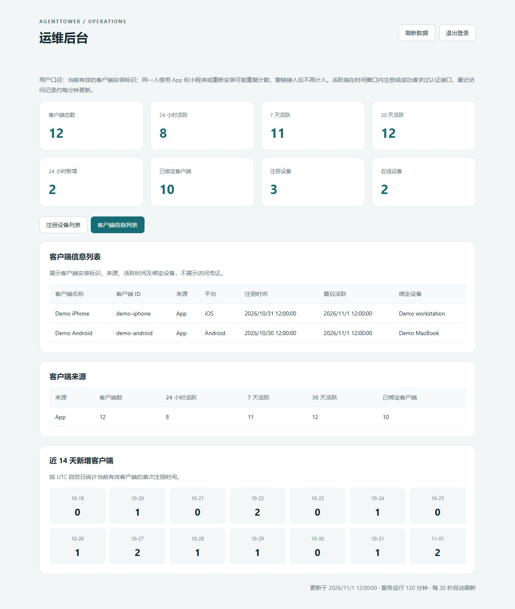

# Agent Tower Server

**A self-hosted relay connecting AI coding agents on your computers to control clients.**

[简体中文](README.md) · [Connector source](https://github.com/agenttower-ai/agent-connector) · [Flutter client source](https://github.com/agenttower-ai/agent-tower-client) · [iOS App Store](https://apps.apple.com/app/id6820363505)

AgentTower lets you follow AI coding tasks, review conversations and handle supported approval requests away from your desk. This repository contains the **Node.js relay server**: device pairing, access relationships and messages between Connector and compatible clients.

## Related projects

| Project | Role |
| --- | --- |
| [Agent Connector](https://github.com/agenttower-ai/agent-connector) | Runs on the computer with your AI agents; syncs status and supported operations |
| [Agent Tower Server](https://github.com/agenttower-ai/agent-tower-server) | Pairs devices, manages access and relays messages |
| [Agent Tower Client](https://github.com/agenttower-ai/agent-tower-client) | Flutter client for progress, conversations and supported approvals |

Use all three with the same relay for a complete self-hosted setup. Agent capabilities vary by adapter.

## Use cases

| Situation | Server's role |
| --- | --- |
| Follow a long task from another device | Forward status and session data between Connector and authorized clients |
| Review an agent operation remotely | Relay supported approval requests, decisions and execution receipts |
| Work across several computers | Manage pairing and client-to-device authorization relationships |
| Run your own relay | Provide standalone Node.js source, local tests and a built-in management UI |

Server does not run AI models or replace your agents. Tasks run on the original computer. Available operations depend on the Connector adapter and client.

## Three screenshots

### 1. Devices and connections



### 2. Client installations



### 3. Sources and activity



These are the actual built-in Server management screens with synthetic demonstration data, not production statistics. The management UI at `/ops/` requires separate administrator credentials and is disabled when these are unset. It shows registered devices, current connections, client installations, binding relationships and activity summaries without displaying access credentials.

## How it works

```text
Local AI agent ↔ AgentTower Connector ↔ Server (this repository) ↔ Compatible client
```

1. Run [Connector](https://github.com/agenttower-ai/agent-connector) on the computer running your agent and point it at your relay.
2. Pair from a compatible client connected to the same relay using the one-time binding code.
3. Follow forwarded status and conversations, and handle operations supported by the adapter.

## Run locally

Requires Node.js 20 or later. From the repository root:

```sh
npm ci --omit=dev
npm start
```

By default, Server listens on `127.0.0.1:17655`. Check `http://127.0.0.1:17655/health`. Persistent data is written to `data/` in the working directory.

```sh
node --test tests/*.test.cjs
```

## Optional configuration

Set process environment variables; Server does not automatically load `.env` files.

| Variable | Purpose |
| --- | --- |
| `HOST` / `PORT` | Local listening address and port |
| `AGENTTOWER_DEVICE_STORE` | Device persistence file path |
| `AGENTTOWER_MOBILE_STORE` | Client persistence file path |
| `AGENTTOWER_WEB_ORIGIN` | Exact permitted Web client origin |
| `AGENTTOWER_ADMIN_USERNAME` / `AGENTTOWER_ADMIN_PASSWORD` | Separate optional management credentials; management is disabled when unset |

New clients use independent installation credentials and one-time pairing codes rather than a shared App Key. Announcements and project links are empty by default. The agent list does not bundle brand images. For self-hosting, provide HTTPS/WSS and use Connector and clients connected to that same service.

Traffic is not end-to-end encrypted: Server can read forwarded content. Protect persistence files containing device/client relationships and operational metadata. In-memory events are not a persistent audit log. Never publish runtime data, real logs, production configuration or credentials.

## Scope and license

This repository includes server source, the built-in management UI, tests and empty content configuration. Production deployment scripts, server addresses, accounts, data and credentials are excluded. Connector and Flutter client source are maintained separately.

The [license](LICENSE) is **MIT with additional attribution-preserving terms**, not standard MIT. Commercial use, modification and redistribution are allowed without requiring disclosure of your business source or modifications. Preserve copyright notices, the full license and existing AgentTower attribution in service identifiers; you may add your own product name alongside it. Refer to the complete license for the terms.

Dependencies retain their own licenses; see [THIRD_PARTY.md](THIRD_PARTY.md). To contribute, see [CONTRIBUTING.md](CONTRIBUTING.md). For sensitive reports, follow [SECURITY.md](SECURITY.md).
