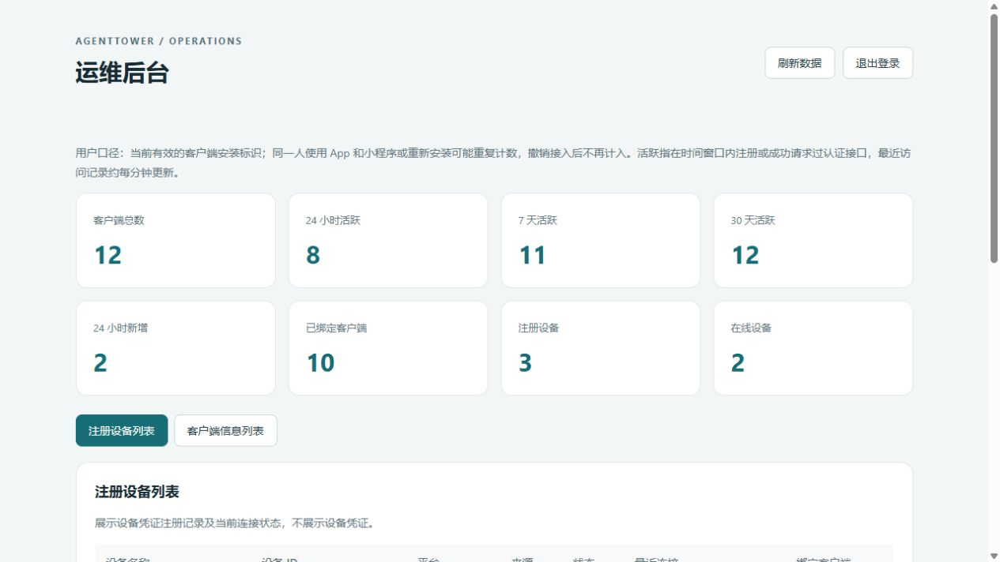
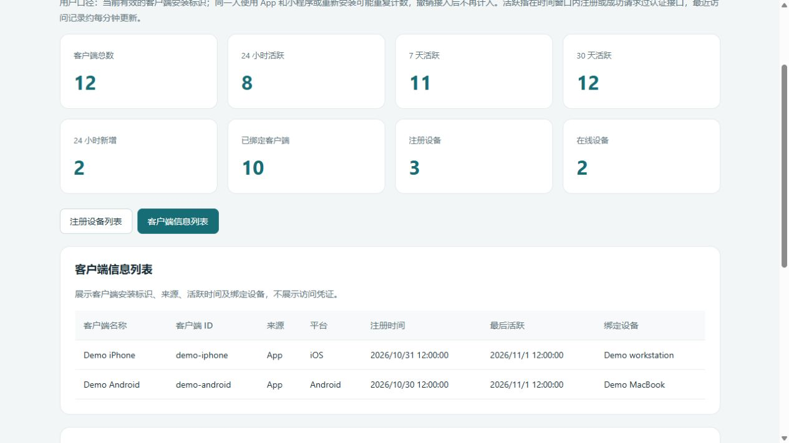
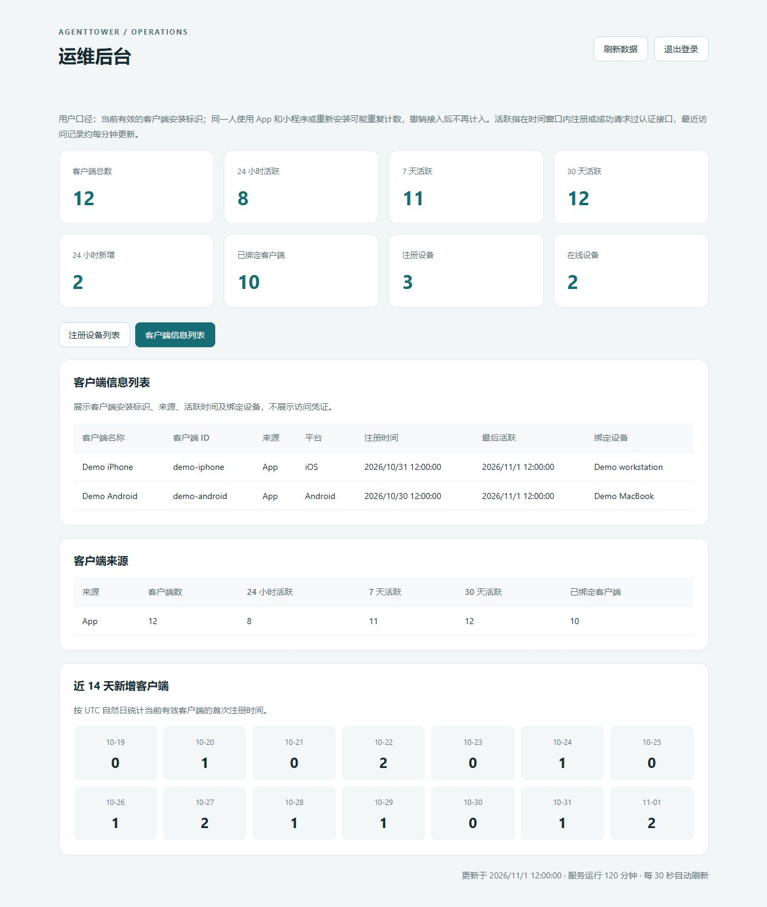

# Agent Tower Server

**连接电脑上的 AI Agent 与控制客户端的自托管中转服务。**

[English](README.en.md) · [Connector 源码](https://github.com/agenttower-ai/agent-connector) · [iOS App Store](https://apps.apple.com/app/id6820363505)

AgentTower 让你离开电脑后，仍能查看 AI 编程 Agent 的进展、跟进会话，并处理适配器支持的操作审批。这个仓库是其中的 **Node.js 服务端**，负责设备绑定、访问授权以及 Connector 与兼容控制客户端之间的消息转发。

## 关联项目

| 项目 | 负责什么 |
| --- | --- |
| [Agent Connector](https://github.com/agenttower-ai/agent-connector) | 运行在 Agent 所在的电脑，同步状态与受支持的操作 |
| [Agent Tower Server](https://github.com/agenttower-ai/agent-tower-server) | 设备绑定、访问授权和消息中转 |
| [Agent Tower Client](https://github.com/agenttower-ai/agent-tower-client) | Flutter 客户端，查看进展、会话并处理受支持的审批 |

完整自托管需要三者连接同一个中转服务；各 Agent 的可用能力取决于适配器。

## 使用场景

| 场景 | Server 提供什么 |
| --- | --- |
| 从其他设备跟进电脑上的长任务 | 在 Connector 与已授权客户端之间转发状态及会话数据 |
| 远程处理 Agent 的操作确认 | 转发受支持的审批请求、决定与操作回执 |
| 同时使用多台电脑 | 管理设备绑定和客户端与设备之间的授权关系 |
| 希望自己运行中转服务 | 提供可独立运行的 Node.js 源码、本地测试及内置管理界面 |

Server 不运行 AI 模型，也不替代电脑上的 Agent。任务仍在原电脑执行；可用操作取决于 Connector 适配器及客户端支持。

## 三张截图

### 1. 设备与连接状态



### 2. 客户端安装列表



### 3. 来源与活跃统计



以上为 Server 内置管理后台的实际页面，全部使用虚构演示数据，不代表生产统计。`/ops/` 后台需要单独配置管理员账号密码，未配置时禁用。可查看注册设备、连接状态、客户端安装标识、绑定关系及活跃统计，不展示访问凭证。

## 工作方式

```text
本机 AI Agent ↔ AgentTower Connector ↔ Server（本仓库）↔ 兼容控制客户端
```

1. 在运行 Agent 的电脑上启动 [Connector](https://github.com/agenttower-ai/agent-connector)，指向自己的中转服务。
2. 使用连接同一服务的兼容客户端，通过一次性绑定码确认设备关系。
3. 查看转发的状态、会话，并按适配器能力处理审批等操作。

## 开源范围与许可

AgentTower 独立 Node.js 中转服务，采用 [MIT + 标识保留补充条款](LICENSE) 自定义许可。允许商用、修改和分发，不要求公开业务源码或修改代码；必须保留版权、完整许可及服务标识中已有的 AgentTower 来源信息，可并列添加自己的产品名称。这不是标准 MIT 许可。

在 Connector 和兼容的控制客户端之间转发设备状态、会话数据和受支持的操作。

本仓库包含服务端源码、内置管理界面、测试和空白内容配置。生产部署脚本、服务器地址、账号、数据和凭证不包含在内。

## 本地运行与验证

需要 Node.js 20 或以上版本，在仓库根目录运行：

```sh
npm ci --omit=dev
npm start
```

默认监听 `127.0.0.1:17655`，健康检查为 `http://127.0.0.1:17655/health`。持久化数据默认写入当前工作目录的 `data/`。

```sh
node --test tests/*.test.cjs
```

## 可选运行参数

通过进程环境变量设置；服务不自动读取 `.env` 文件。

| 变量 | 用途 |
| --- | --- |
| `HOST` / `PORT` | 本机监听地址和端口 |
| `AGENTTOWER_DEVICE_STORE` | 设备持久化文件路径 |
| `AGENTTOWER_MOBILE_STORE` | 手机持久化文件路径 |
| `AGENTTOWER_WEB_ORIGIN` | Web 客户端允许的准确来源 |
| `AGENTTOWER_ADMIN_USERNAME` / `AGENTTOWER_ADMIN_PASSWORD` | 可选管理后台独立凭证，未配置时禁用 |

新客户端使用独立安装凭证与一次性绑定码，不需要共享 App Key。公告与项目链接配置默认为空。Agent 列表不含品牌图片。

自托管需自行配置 HTTPS/WSS，并使用连接相同服务的 Connector 和兼容客户端。本仓库不含手机客户端。

没有端到端加密，服务端可以读取转发内容。保护持久化文件，其中包含设备、手机关系及运维元数据。内存中的事件不是持久化审计日志。不要提交运行数据、真实日志、生产配置或凭证。

第三方依赖参见 [THIRD_PARTY.md](THIRD_PARTY.md)。
